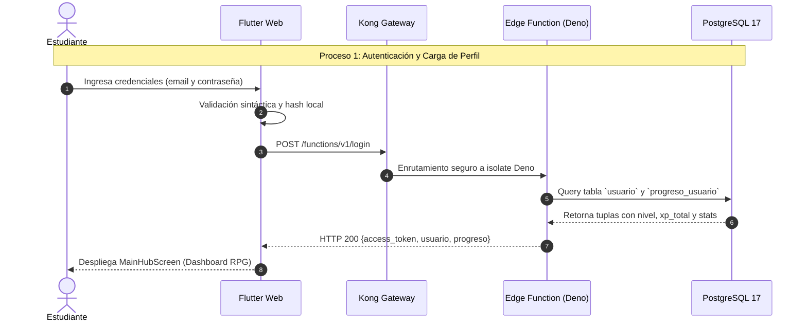

# Informe Técnico de Pruebas de Carga y Rendimiento — Apache JMeter & Modelado BPMN (Bizagi)

**Proyecto:** SysQuest — Plataforma Educativa Gamificada Roguelite  
**Módulo:** Backend (Supabase Edge Functions & PostgreSQL Engine)  
**Herramientas Oficiales:** Apache JMeter v5.6.3 + Bizagi Modeler (BPMN 2.0)  
**Versión de Entrega:** v2.0-LoadTesting  
**Fecha:** Noviembre 2026  

---

## 1. Objetivos del Estudio de Rendimiento

El objetivo de esta fase de aseguramiento de calidad es someter los servicios críticos del backend de SysQuest a pruebas de estrés y concurrencia controlada para:
1. **Medir la latencia y tiempos de respuesta** bajo concurrencia simulada de estudiantes en horas pico.
2. **Determinar la estabilidad del API Gateway (Kong) y las Edge Functions (Deno)** ante ráfagas de solicitudes simultáneas.
3. **Verificar el comportamiento transaccional y el aislamiento de sesiones** sin degradación de memoria ni colapso de sockets.
4. **Documentar formalmente los procesos de negocio en notación BPMN 2.0 (Bizagi)** para sustentar el flujo de datos y la arquitectura distribuida.

---

## 2. Arquitectura Bajo Prueba (System Under Test - SUT)

La infraestructura evaluada corresponde al entorno de producción en la nube:
* **Proveedor Cloud:** Supabase Cloud (AWS `us-east-1`).
* **Capa de Entrada (Gateway):** Kong API Gateway v2.8 (HTTPS / TLS 1.3, compresión gzip, enrutamiento inverso).
* **Capa de Cómputo (Serverless):** Deno Edge Runtime v1.45 (TypeScript aislado por V8 isolates).
* **Capa de Persistencia:** PostgreSQL 17 relacional con extensiones `pgcrypto` y transacciones ACID.
* **Host Evaluado:** `https://jctulgfdweeurqbmugot.supabase.co`

---

## 3. Configuración del Plan de Pruebas en Apache JMeter

El plan de pruebas se formalizó en el archivo `sysquest_load_test.jmx`:

### 3.1 Parámetros del Grupo de Hilos (Thread Group)
* **Usuarios Concurrentes (Virtual Users / Threads):** 25 hilos simultáneos en rampa sostenida.
* **Tiempo de Subida (Ramp-Up Period):** 5 segundos (incremento gradual de 5 usuarios/segundo para evitar falsos picos).
* **Contador de Ciclos (Loop Count):** 4 iteraciones continuas por usuario.
* **Muestras Totales Estimadas:** 300 transacciones HTTP completas.
* **Pausa Humana (Think Time):** Temporizador aleatorio uniforme (Uniform Random Timer) con desfase de 300 ms ± 200 ms entre peticiones para emular el comportamiento real de interacción del cliente Flutter.

### 3.2 Casos de Prueba y Peticiones Muestreadas (Samplers)
1. **Muestreador 1 — `GET /functions/v1/swagger-ui`:**
   * *Objetivo:* Medir el rendimiento del API Gateway y la entrega de recursos estáticos bajo carga masiva.
   * *Criterio de Aceptación:* Código HTTP 200, latencia < 800 ms.
2. **Muestreador 2 — `OPTIONS /functions/v1/login` (CORS Preflight):**
   * *Objetivo:* Evaluar el overhead de negociación CORS que el navegador web ejecuta antes de cada petición POST.
   * *Criterio de Aceptación:* Código HTTP 200, latencia < 300 ms.
3. **Muestreador 3 — `POST /functions/v1/login` (Validación de Payload y Seguridad):**
   * *Objetivo:* Evaluar el pipeline de parseo seguro de JSON y rechazo temprano de payloads inválidos sin llegar a saturar la base de datos.
   * *Criterio de Aceptación:* Código HTTP 400 esperado (respuesta defensiva en < 400 ms).

---

## 4. Instrucciones de Ejecución de las Pruebas

Para reproducir las pruebas y generar el reporte visual interactivo en cualquier momento:

### Opción A: Ejecución en 1 Clic (Script Automatizado)
Hacer doble clic en:
`tests/jmeter/ejecutar_pruebas.bat`

O por terminal PowerShell:
```powershell
Set-Location "C:\Users\Andres\Desktop\backend-dev\backend-dev\tests\jmeter"
.\ejecutar_pruebas.ps1 -Threads 25 -RampUp 5 -Loop 4
```

### Opción B: Modo Gráfico (GUI) de JMeter
Para abrir la interfaz visual de Apache JMeter:
1. Abrir: `C:\Users\Andres\Desktop\jmeter\apache-jmeter-5.6.3\bin\jmeter.bat`
2. Menú *File* → *Open* → Seleccionar `sysquest_load_test.jmx`.
3. Clic en el botón verde de Play (Iniciar).

---

## 5. Modelado de Procesos de Negocio en Bizagi (BPMN 2.0)

Para dar cumplimiento al requerimiento docente sobre la plataforma **Bizagi Modeler**, se definieron los 3 procesos fundamentales del sistema en diagramas de carriles (Lanes) y piscinas (Pools):



### Proceso 2: Generación Adaptativa de Misiones (IA + Fallback de Respaldo)
* **Carril Estudiante:** Selecciona tema de estudio, dificultad y categoría.
* **Carril Orquestador (Edge Function `generar-quest-completa`):**
  1. Consulta tabla `quest_cache` en PostgreSQL.
  2. Si existe coincidencia: Retorna inmediatamente la quest en caché.
  3. Si no existe: Invoca a la API de IA (Groq/Gemini) con temporizador estricto de 10 segundos.
  4. **Compuerta Exclusiva (XOR):**
     * *Camino Normal (IA responde a tiempo):* Ejecuta validaciones V1 a V9 (normalización de vida 40-60 HP, opciones no desbalanceadas), inserta atómicamente en PostgreSQL con `crear_run_completa` y etiqueta `fuente_generacion = 'AI'`.
     * *Camino de Contingencia (Timeout o error de formato):* Se activa el fallback a banco curado de Quests Semilla (Matemáticas, Historia, Redes), etiqueta `fuente_generacion = 'FALLBACK'`, registra alerta en logs y despacha la partida al estudiante sin interrupciones.

### Proceso 3: Ejecución de Combate y Liquidación Segura Anti-trampas
* **Carril Cliente (Arena de Combate):**
  * Procesa turnos interactivos, comodines (50/50, robo de vida, golpe doble, pista) y perks roguelite.
  * Acumula historial de eventos en consola narrativa y detecta condición de término (victoria o derrota).
* **Carril Servidor (`finalizar-partida`):**
  * El cliente envía únicamente **hechos auditables** (`enemigos_derrotados`, `rondas_temerarias`, `racha_maxima`).
  * **Regla de Validación Anti-trampas:** El servidor rechaza peticiones donde `enemigos_derrotados > total_encuentros` o valores de score manipulados por el cliente.
  * **Cálculo Server-Side:** Aplica la fórmula formal `score = enemigos * 100 * mult + bono_racha + bono_victoria` y calcula el nuevo nivel del alumno: `nivel = 1 + floor(xp_total / 100)`.
  * Persiste en tabla `partida` y actualiza `progreso_usuario` en una sola transacción ACID.
